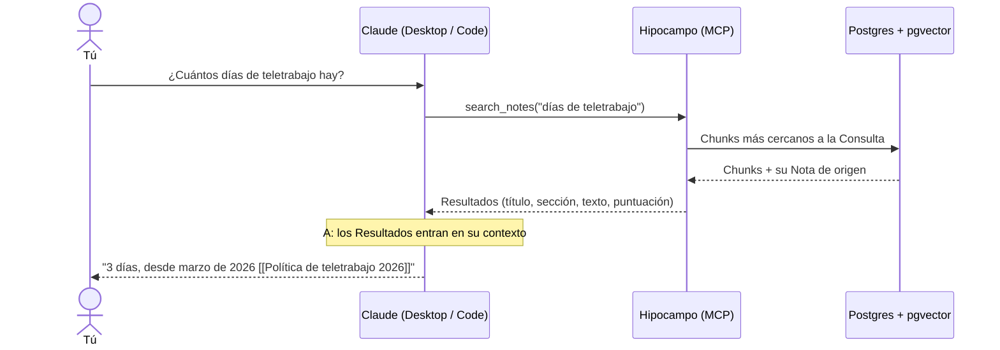
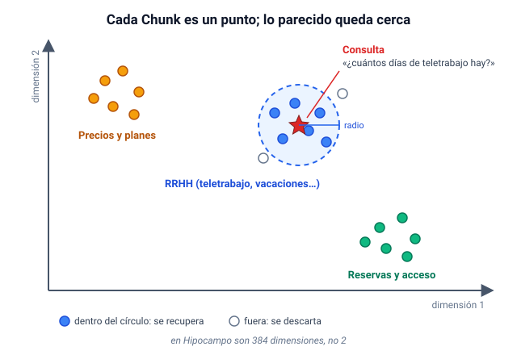
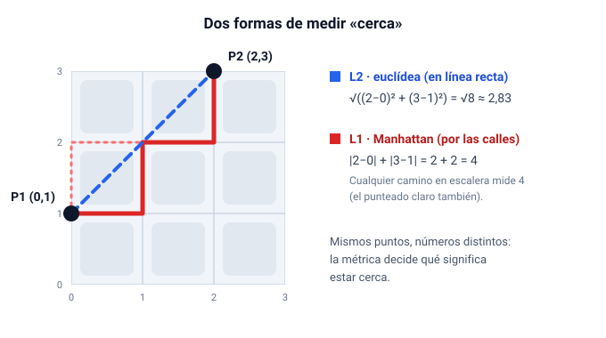
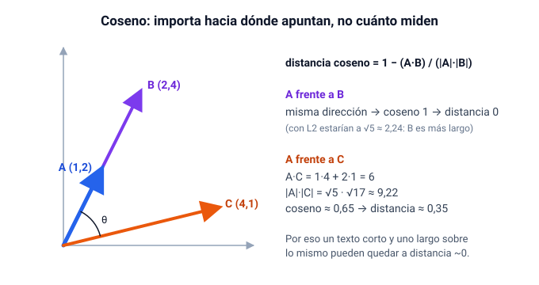
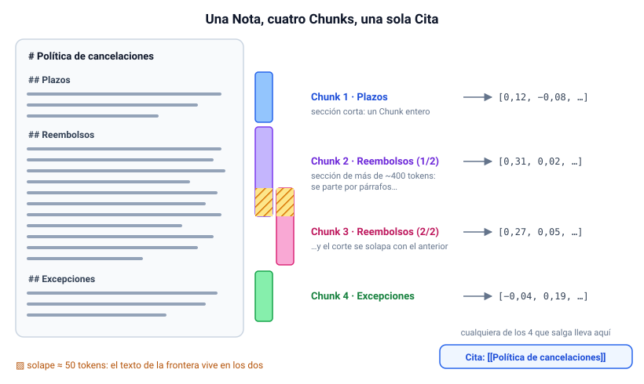
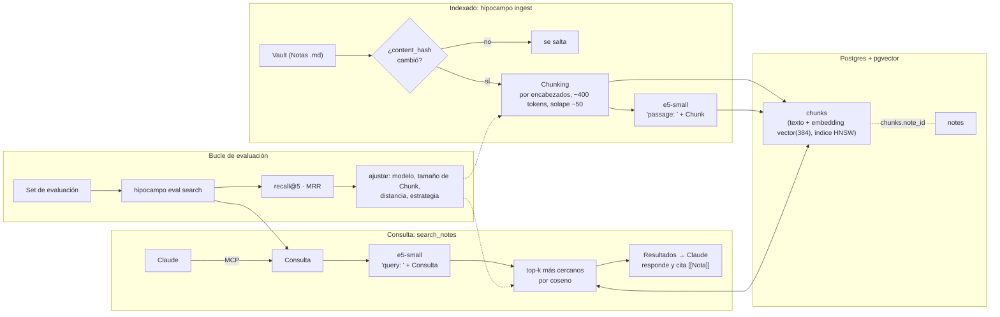
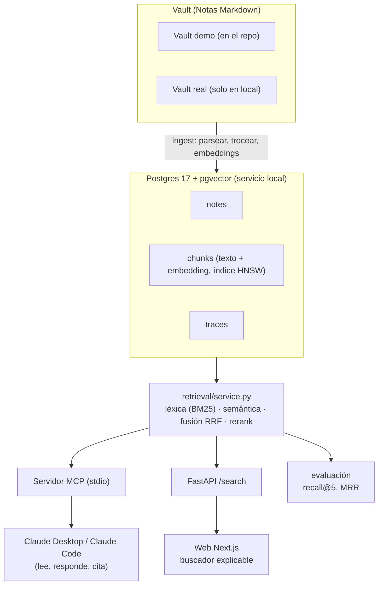

# Hipocampo

> El hipocampo es la parte del cerebro que indexa los recuerdos y ayuda a recuperarlos. Este proyecto hace eso para un segundo cerebro: indexa Notas y recupera las que hacen falta.

Hipocampo es un motor de búsqueda local sobre vaults de [Obsidian](https://obsidian.md). Dada una Consulta, encuentra las Notas relevantes y se las da a Claude a través de un servidor MCP, para que Claude responda citándolas. Es la **R** de un RAG: la parte de recuperar.

Es un proyecto para aprender, y por eso este README empieza explicando qué es un RAG y cómo se traduce cada idea en una decisión concreta del proyecto.

- Especificación: [`docs/SPEC.md`](docs/SPEC.md) · Plan por fases: [`docs/PLAN.md`](docs/PLAN.md) · Glosario: [`CONTEXT.md`](CONTEXT.md) · Decisiones: [`docs/adr/`](docs/adr/)
- Estado: **en construcción**. Fase 0 (esqueleto del proyecto) terminada.

## Índice

1. [Qué es un RAG](#qué-es-un-rag)
2. [La idea central: un círculo alrededor de la Consulta](#la-idea-central-un-círculo-alrededor-de-la-consulta)
3. [Las tres piezas que necesitas](#las-tres-piezas-que-necesitas)
4. [Qué significa «cerca»: L1, L2 y coseno](#qué-significa-cerca-l1-l2-y-coseno)
5. [Mismo modelo, mismas dimensiones](#mismo-modelo-mismas-dimensiones)
6. [Chunking: trocear las Notas con solape](#chunking-trocear-las-notas-con-solape)
7. [Indexado incremental](#indexado-incremental)
8. [El circuito completo](#el-circuito-completo)
9. [El bucle de evaluación: recall y precisión](#el-bucle-de-evaluación-recall-y-precisión)
10. [Lo que Hipocampo añade a lo básico](#lo-que-hipocampo-añade-a-lo-básico)
11. [Arquitectura](#arquitectura) · [Cómo empezar](#cómo-empezar-windows-nativo-sin-wsl2-ni-docker) · [Por qué estas decisiones](#por-qué-estas-decisiones) · [Resultados](#resultados) · [Fuentes](#fuentes)

---

## Qué es un RAG

**RAG** son las siglas de *Retrieval-Augmented Generation*: generación aumentada con recuperación. Tiene tres partes:

| Letra | Qué hace | En Hipocampo |
|---|---|---|
| **R** · *Retrieval* | Buscar, en una fuente externa, los trozos de información que tienen que ver con la pregunta. | Lo hace Hipocampo: busca en el Vault y devuelve Resultados. |
| **A** · *Augmented* | Meter esos trozos en el contexto del modelo, junto a la pregunta. | Lo hace Claude al llamar a la herramienta `search_notes` del servidor MCP. |
| **G** · *Generation* | El modelo redacta la respuesta apoyándose en lo que le has dado. | Lo hace Claude, con la suscripción, citando `[[Nota]]`. |

El problema que resuelve es sencillo. Un modelo solo sabe lo que aprendió al entrenarse y lo que le pones delante en la conversación. No conoce tu Vault. La salida fácil es pegarle todo el Vault en el prompt, y con un Vault pequeño funciona (es la línea base que Hipocampo mide siempre, el **Contexto completo**). Pero cuando hay cientos de Notas, no cabe todo, o cabe pero el modelo se pierde, o cada pregunta cuesta mucho. Un RAG elige **solo lo relevante** para cada pregunta y se lo da al modelo.

Hipocampo hace solo la R a propósito ([ADR 0001](docs/adr/0001-solo-busqueda-y-claude-por-mcp.md)): no llama a ninguna API de pago. Claude, conectado por MCP, decide cuándo buscar, lee los Resultados y redacta.



## La idea central: un círculo alrededor de la Consulta

Imagina que pudieras colocar cada trozo de texto del Vault como un punto en un mapa, de forma que los textos que hablan de lo mismo queden juntos. Las Notas de precios en una esquina, las de RRHH en otra, las de reservas en otra. Eso es un **embedding**: convertir un texto en una lista de números (unas coordenadas) de manera que **la cercanía en el mapa signifique cercanía de significado**.

Con ese mapa, buscar es geometría. Conviertes la Consulta en un punto del mismo mapa, trazas un círculo a su alrededor y te quedas con lo que cae dentro.



En el dibujo hay dos dimensiones para que se vea. El modelo que usa Hipocampo produce **384 dimensiones**: el mapa es imposible de dibujar, pero la idea es la misma.

Hay dos formas de trazar ese «círculo»:

- **Por radio (umbral de distancia):** todo lo que esté a menos de X. Si nada está cerca, no devuelve nada, y eso es útil para detectar preguntas sin respuesta. El problema es que el umbral bueno depende del modelo y hay que ajustarlo a mano.
- **Por los k más cercanos (top-k):** los k puntos más próximos, estén donde estén. Siempre devuelve algo. **Hipocampo usa top-k** (`top_k=8` por defecto) y deja que Claude decida si lo que llegó responde o no. Para eso las instrucciones del servidor MCP le piden decir «no aparece en el vault» cuando no está.

## Las tres piezas que necesitas

Para montar esa búsqueda hacen falta tres cosas:

| Pieza | Para qué | En Hipocampo |
|---|---|---|
| **1. Un modelo de embedding** | Pasar de texto a vector. A los Chunks al indexar y a la Consulta al buscar. | `intfloat/multilingual-e5-small`, en local y en CPU. 384 dimensiones, entiende español ([ADR 0005](docs/adr/0005-embeddings-locales-e5-small.md)). |
| **2. Una base de datos que guarde el vector junto a su origen** | No basta con guardar números: cuando un vector sale cerca, tienes que saber de qué Nota venía para poder devolverla y citarla. | Postgres con la extensión `pgvector`, instalado nativo en Windows. Es la combinación más habitual en la industria ([ADR 0007](docs/adr/0007-postgres-pgvector-en-windows-nativo.md)). |
| **3. Una métrica de distancia** | Definir qué es «estar cerca». | Coseno (siguiente apartado). |

**Sobre la pieza 1.** El modelo corre en el propio ordenador porque es gratis y porque el Vault real (salud, finanzas, personas) no debe salir de él. Un modelo en la nube daría vectores parecidos, pero cada Consulta y cada Nota viajarían a un tercero.

**Sobre la pieza 2.** La forma típica, y la que usa Hipocampo, es Postgres con la extensión pgvector: añade un tipo de columna `vector` a una tabla normal, así que el vector vive en la misma fila que el texto del Chunk, y cada Chunk apunta a su Nota.

```sql
-- db/migrations/001_init.sql (simplificado)
CREATE EXTENSION vector;

CREATE TABLE notes  (id BIGSERIAL PRIMARY KEY, path TEXT, title TEXT, content_hash TEXT, ...);
CREATE TABLE chunks (
  id        BIGSERIAL PRIMARY KEY,
  note_id   BIGINT REFERENCES notes(id) ON DELETE CASCADE,
  text      TEXT,
  embedding vector(384),   -- las 384 coordenadas del Chunk
  ...
);

-- índice para encontrar vecinos cercanos sin comparar con todos
CREATE INDEX ON chunks USING hnsw (embedding vector_cosine_ops);
```

Así se hace el camino de vuelta: vector cercano → su fila de `chunks` → `chunks.note_id` → la Nota que se cita. Todo en una consulta SQL:

```sql
SELECT n.title, c.text, c.embedding <=> :consulta AS distancia
FROM chunks c JOIN notes n ON n.id = c.note_id
ORDER BY distancia
LIMIT 8;
```

El índice **HNSW** es aproximado: en vez de comparar la Consulta con todos los vectores, recorre un grafo de vecinos y casi siempre encuentra los mismos que la búsqueda exacta, mucho más rápido. Con cientos de Notas la búsqueda exacta también sería instantánea, pero el índice es lo que encontrarás en cualquier proyecto real, y medir cuánto se equivoca es parte de la Fase 3.

## Qué significa «cerca»: L1, L2 y coseno

Una distancia es una función: le das dos puntos y te devuelve un número que dice cuánto se parecen (0 = iguales). Hay muchas, y cada una da números distintos para los mismos puntos. Las tres que importan aquí:



**L2, euclídea.** La línea recta, la de toda la vida. Entre P1 = (0, 1) y P2 = (2, 3):

$$\sqrt{(2-0)^2 + (3-1)^2} = \sqrt{8} \approx 2{,}83$$

**L1, Manhattan.** Imagina que solo puedes moverte por calles en cuadrícula, como en el Eixample de Barcelona: no puedes cruzar en diagonal por dentro de las manzanas, solo avanzar en horizontal o en vertical. Sumas lo que avanzas en cada eje:

$$|2-0| + |3-1| = 2 + 2 = 4$$

Da igual qué ruta en escalera elijas, siempre mide 4. Mismos puntos, otro número: **la métrica decide qué significa estar cerca.**



**Coseno.** No mira dónde acaba cada punto, sino **hacia dónde apunta** su flecha desde el origen. Mide el ángulo entre las dos:

$$\text{distancia coseno} = 1 - \frac{A \cdot B}{|A|\,|B|}$$

- A = (1, 2) y B = (2, 4) apuntan exactamente igual (B es A el doble de largo). Coseno = 1, distancia = **0**. Con L2 estarían a √5 ≈ 2,24.
- A = (1, 2) y C = (4, 1): A·C = 1·4 + 2·1 = 6; |A|·|C| = √5 · √17 ≈ 9,22; coseno ≈ 0,65 → distancia ≈ **0,35**.

Por eso el coseno es la métrica habitual para texto: una Nota corta y una larga que hablan de lo mismo apuntan en la misma dirección aunque sus vectores «midan» distinto. Y por eso palabras que no se parecen en letras pero sí en significado (médico y enfermera, teletrabajo y remoto) acaban cerca: el modelo ya las colocó apuntando a sitios parecidos.

**En Hipocampo:** búsqueda semántica por **coseno** ([SPEC §10](docs/SPEC.md)). Un detalle útil: si los vectores están normalizados (todos de longitud 1, lo habitual con e5), ordenar por L2 o por coseno da **el mismo orden**, porque en ese caso L2² = 2 − 2·coseno. pgvector trae las tres como operadores (`<->` L2, `<+>` L1 y `<=>` coseno), así que se puede comprobar midiendo.

## Mismo modelo, mismas dimensiones

Un vector solo tiene sentido comparado con otro **del mismo modelo**. Cada modelo construye su propio mapa: si indexas las Notas con un modelo y conviertes la Consulta con otro, estás midiendo la distancia entre un punto de un mapa de Madrid y otro de un mapa de Tokio. El número sale, pero no significa nada, y **no da error**.

Además cada modelo tiene su número de dimensiones, y la columna del vector se crea con ese número fijo:

| Modelo | Dimensiones | Papel en Hipocampo |
|---|---|---|
| `intfloat/multilingual-e5-small` | 384 | El de por defecto. Ligero, corre en CPU. |
| `BAAI/bge-m3` | 1024 | Se compara una vez en la fase 3 para ver si compensa su tamaño (~2 GB). |

Consecuencias en Hipocampo ([ADR 0005](docs/adr/0005-embeddings-locales-e5-small.md)):

- Cambiar de modelo obliga a **recrear `chunk_embeddings`** con la nueva dimensión y a reindexar todo el Vault.
- e5 tiene una trampa extra: espera el prefijo `passage: ` al indexar y `query: ` al buscar. Sin ellos funciona igual de rápido pero recupera peor, sin avisar. Es el mismo fallo silencioso que mezclar modelos, y por eso hay un test que lo comprueba.

## Chunking: trocear las Notas con solape

Si conviertes una Nota entera en un único vector, y la Nota habla de tres cosas, el vector acaba en un punto intermedio que no representa bien ninguna de las tres. La solución es **trocearla en Chunks** y darle un vector a cada uno. Así una Consulta puede caer muy cerca del Chunk 2 aunque el Chunk 4 hable de otra cosa, y la Nota sale igualmente.



El **solape** sirve para no partir una idea por la mitad. Si la frase clave queda justo en la frontera entre dos Chunks, con solape aparece entera en los dos y la búsqueda la encuentra igual.

Cómo trocea Hipocampo ([SPEC §8](docs/SPEC.md)):

1. **Por encabezados.** Cada sección (`##`, `###`) es un Chunk. Las Notas de Obsidian ya vienen organizadas por temas, y eso es mejor frontera que cortar cada N palabras.
2. **Si una sección pasa de ~400 tokens**, se parte por párrafos con **~50 tokens de solape** (el caso de «Reembolsos» en el dibujo).
3. **Si es muy corta** (< 40 tokens), se une a la siguiente para que no queden Chunks sin contenido.
4. **Encabezado de contexto.** A cada Chunk se le antepone, solo para indexar, `Nota: <título> · Sección: <ruta> · Área: <área> · Fecha: <fecha>`. Así un trozo suelto como «son 3 días» sigue sabiendo que habla del teletrabajo en 2026.

Un Chunk siempre pertenece a una sola Nota, y lo que se cita es la Nota, nunca el Chunk. Los tamaños son parámetros: la fase 3 compara varias configuraciones con la evaluación, porque no hay un tamaño correcto en abstracto.

## Indexado incremental

Indexar es pasar todo el Vault por el pipeline (trocear, calcular vectores, guardar). Con e5 en una CPU antigua tarda, así que no quieres repetirlo entero cada vez que editas una Nota. La idea es guardar una **huella** de cada Nota y reprocesar solo las que cambiaron.

En Hipocampo ([SPEC §8](docs/SPEC.md), fase 7):

- Cada Nota guarda `content_hash`, el SHA-256 de su archivo. Si cambias una coma, el hash cambia.
- `hipocampo ingest` compara el hash del archivo con el guardado. Igual → se salta. Distinto o nuevo → se trocea y se recalculan sus vectores. Archivos que ya no existen → se borran sus Notas y Chunks.
- Cada Nota se guarda en una transacción: si falla a mitad, no queda medio indexada.
- **Idempotente:** ejecutarlo dos veces seguidas no cambia nada. Hay un test para eso.

No hay un proceso que se dispare solo cada pocos minutos, como haría un sistema en la nube: es un comando que se lanza cuando hace falta. En local y con un único usuario no necesita más.

## El circuito completo

Juntando todo, hay dos caminos que comparten el modelo de embedding y la base de datos, y un bucle que los mide:



## El bucle de evaluación: recall y precisión

Probar a mano un par de preguntas y ver que «parece que va» no sirve para comparar. Si cambias el tamaño de Chunk o el modelo, necesitas saber con una cifra si has mejorado o empeorado. Para eso existe un **Set de evaluación**: preguntas en las que tú ya sabes qué Nota debería salir.

```yaml
# eval/demo.yaml
- id: q017
  type: temporal
  question: "¿Cuántos días de teletrabajo a la semana permite la política actual?"
  relevant_notes: ["RRHH/Politica de teletrabajo 2026.md"]
  distractor_notes: ["RRHH/Politica de teletrabajo 2025.md"]
```

Se lanzan todas contra la búsqueda y se cuenta. Las dos métricas clásicas, con un ejemplo: la búsqueda devuelve 5 Notas, y la única relevante (la política de 2026) está en el puesto 2.

| Métrica | Pregunta que responde | En el ejemplo |
|---|---|---|
| **Recall** | De las Notas que debían salir, ¿cuántas salieron? | 1 de 1 → **100 %** |
| **Precisión** | De las Notas que salieron, ¿cuántas eran relevantes? | 1 de 5 → **20 %** |

Las dos tiran en sentidos opuestos: si devuelves más Resultados, sube el recall y baja la precisión.

**En Hipocampo** ([SPEC §14](docs/SPEC.md), [ADR 0006](docs/adr/0006-evaluacion-primero-con-contexto-completo.md)):

- **recall@5**: ¿hay alguna Nota relevante entre las 5 primeras? Es la métrica principal porque quien lee los Resultados es Claude: puede descartar Resultados que sobran, pero no puede usar una Nota que no le llegó.
- **MRR** (*Mean Reciprocal Rank*): la media de 1/posición de la primera Nota relevante. En el ejemplo, 1/2 = 0,5. Premia que la buena salga arriba, que es lo que no mide recall@5.
- **Temporal correcta@1**: en preguntas como la del teletrabajo, ¿sale la política vigente antes que la de 2025?
- **Se evalúa antes de optimizar.** El Set de evaluación existe antes que la búsqueda semántica, la primera cifra es la de BM25, y ninguna mejora se acepta sin su fila en la tabla de [Resultados](#resultados).
- **Línea base honesta:** también se compara con meter el Vault entero en el prompt (Contexto completo) y con dejar que Claude busque con grep. Si el RAG no gana, es un resultado válido y se cuenta.
- La evaluación de búsqueda no usa ningún LLM: es gratis y se puede repetir tantas veces como haga falta.

## Lo que Hipocampo añade a lo básico

Lo anterior es un RAG semántico mínimo. Hipocampo compara varias **Estrategias de recuperación**, porque los vectores tienen puntos débiles conocidos (nombres propios, cifras, códigos de error):

| Estrategia | Cómo funciona |
|---|---|
| Léxica (BM25) | Busca por palabras, con `bm25s` y stemming en español. Encuentra «Proveedor B» o «SLA 99,9 %» aunque el vector no los distinga. |
| Semántica | El círculo de este README: e5-small + pgvector (HNSW) + coseno. |
| Híbrida | Las dos, fusionadas con *Reciprocal Rank Fusion*. |
| Híbrida + rerank | La híbrida, y un cross-encoder reordena los 20 primeros leyendo Consulta y Chunk juntos. Es la estrategia por defecto. |

Cada Resultado lleva el desglose de cada señal, para poder explicar por qué salió.

## Arquitectura



Un único servicio de búsqueda y tres entradas finas (MCP, HTTP y evaluación) que solo lo llaman. Hay dos Vaults con el mismo formato:

- **Vault demo:** la wiki interna de Tramalia, una SaaS B2B inventada de reservas para centros deportivos ([`docs/DEMO-VAULT.md`](docs/DEMO-VAULT.md)). Es público y está en el repo.
- **Vault real:** un vault personal de Obsidian. Se configura en local y nunca se sube.

Detalle completo en [`docs/SPEC.md`](docs/SPEC.md) §5. Para una explicación sin jerga de lo que hay en el repo ahora mismo, [`docs/aprendizajes/00-fase-0.md`](docs/aprendizajes/00-fase-0.md).

## Cómo empezar (Windows nativo, sin WSL2 ni Docker)

Hacen falta tres cosas: Python (lo gestiona `uv`), **PostgreSQL 17** y la extensión **pgvector**. Postgres se instala con un asistente; pgvector no tiene instalador para Windows y se compila una vez con las Build Tools de Visual Studio. La guía paso a paso, con los errores típicos y un plan B, está en [`docs/INSTALACION-WINDOWS.md`](docs/INSTALACION-WINDOWS.md).

```powershell
# 1. Postgres 17 + pgvector, usuario `hipocampo` y bases `hipocampo` y `hipocampo_test`
#    → docs/INSTALACION-WINDOWS.md (pasos 1 a 4)

# 2. Instalar uv (https://docs.astral.sh/uv/)
powershell -ExecutionPolicy ByPass -c "irm https://astral.sh/uv/install.ps1 | iex"

# 3. Clonar y preparar
git clone https://github.com/alejanfh/hipocampo
cd hipocampo
uv sync --dev
copy .env.example .env        # DATABASE_URL y TEST_DATABASE_URL

# 4. Crear las tablas (aplica db/migrations/)
uv run hipocampo init-db

# 5. Pasar los tests (los de base de datos usan hipocampo_test y la vacían)
uv run pytest
```

## Por qué estas decisiones

Versión corta; el razonamiento completo está en [`docs/adr/`](docs/adr/).

| Decisión | Por qué |
|---|---|
| Postgres + pgvector, nativo en Windows | Es lo habitual en la industria: el vector es una columna más, con SQL, transacciones e índice HNSW. Nativo para no depender de WSL2 ni Docker; el precio es compilar pgvector una vez. Antes fue SQLite + `sqlite-vec` ([ADR 0007](docs/adr/0007-postgres-pgvector-en-windows-nativo.md), que sustituye al [0002](docs/adr/0002-sqlite-en-windows-nativo.md)). |
| Claude (por MCP) redacta, Hipocampo solo busca | Coste cero: usa una suscripción de Claude que ya existe ([ADR 0001](docs/adr/0001-solo-busqueda-y-claude-por-mcp.md)). |
| Embeddings locales con e5-small | Gratis, corre en CPU, entiende español y el Vault real no sale del ordenador ([ADR 0005](docs/adr/0005-embeddings-locales-e5-small.md)). |
| Piezas centrales escritas a mano, sin LangChain ni LlamaIndex | El objetivo es entender cómo funciona, no montar una caja negra ([ADR 0004](docs/adr/0004-piezas-centrales-sin-framework.md)). |
| Evaluar antes de optimizar, contra Contexto completo | Saber con cifras si cada cambio mejora, y si un RAG aporta algo frente a no tenerlo ([ADR 0006](docs/adr/0006-evaluacion-primero-con-contexto-completo.md)). |
| Vault demo de una empresa inventada | Es el caso real de un RAG sobre la documentación de un cliente, y el corpus es lo bastante grande para que las estrategias se diferencien ([ADR 0003](docs/adr/0003-vault-demo-de-empresa-ficticia.md)). |

## Resultados

Se irán rellenando a medida que se ejecute la evaluación de cada fase: recall@5 y MRR por Estrategia de recuperación, y una comparación de calidad de respuesta entre Contexto completo, Búsqueda agéntica con Hipocampo y Búsqueda agéntica con grep.

## Fuentes

- La estructura de la explicación (el círculo alrededor de la Consulta, las tres piezas, L1/L2/coseno, el mismo modelo, el indexado por hash, el chunking con solape y el bucle de evaluación) sigue el vídeo de **BettaTech** sobre cómo implementó un RAG con pgvector para el chat de su academia: [youtube.com/watch?v=lBimeKh88OU](https://www.youtube.com/watch?v=lBimeKh88OU). Los textos, ejemplos y diagramas de este README son propios y están adaptados a Hipocampo.
- [pgvector](https://github.com/pgvector/pgvector) · [psycopg 3](https://www.psycopg.org/psycopg3/) · [`intfloat/multilingual-e5-small`](https://huggingface.co/intfloat/multilingual-e5-small) · [Model Context Protocol](https://modelcontextprotocol.io)

## Licencia

MIT
