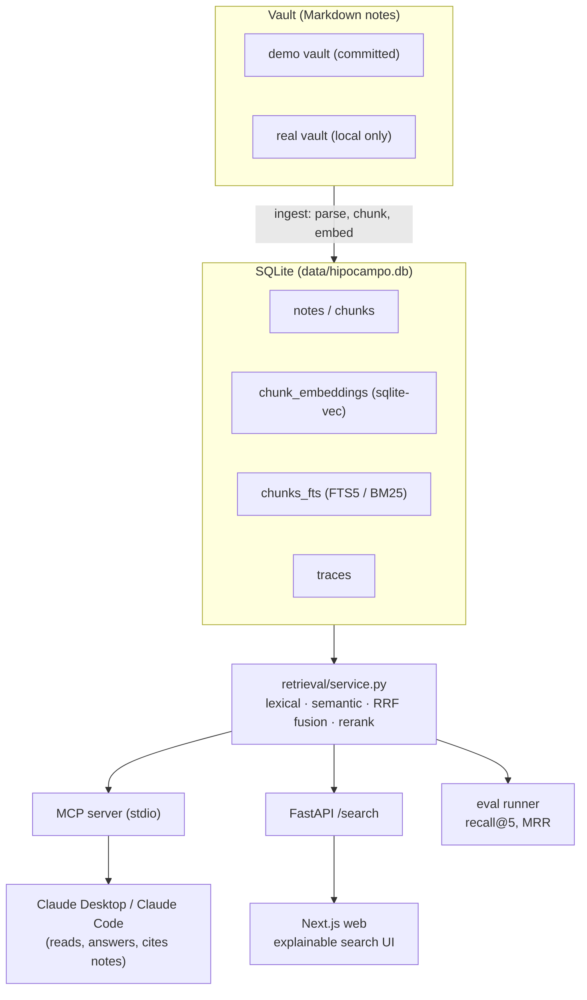

# Hipocampo

A local hybrid-search engine over [Obsidian](https://obsidian.md) vaults, exposed to Claude as an MCP server so it can search, read and cite notes.

> Work in progress — built as a learning project to go deep on Python, retrieval and evaluation for RAG. Spec in [`docs/SPEC.md`](docs/SPEC.md), glossary in [`CONTEXT.md`](CONTEXT.md), phased plan in [`docs/PLAN.md`](docs/PLAN.md), decisions in [`docs/adr/`](docs/adr/).

## What it is

Hipocampo indexes a vault of Markdown notes and answers *"which notes are relevant to this query"* — lexically (BM25 via SQLite FTS5), semantically (local embeddings + `sqlite-vec`), or both fused and reranked. It does **not** call any paid LLM API: it only retrieves. An agent (Claude, via MCP) does the reading and answering.

Two vaults ship with the idea:
- A **demo vault**: the public internal knowledge base of Tramalia, a fictional B2B SaaS company (see [`docs/DEMO-VAULT.md`](docs/DEMO-VAULT.md)).
- A **real vault**: a personal Obsidian vault, configured locally and never committed.

## Architecture



One retrieval service, three thin entry points (MCP, HTTP, evaluation) — none of them hold logic, they only call the service. See [`docs/SPEC.md`](docs/SPEC.md) §5 for the full version.

## Status

Phase 0 (project skeleton): done. See [`docs/PLAN.md`](docs/PLAN.md) for the full roadmap, and [`docs/aprendizajes/00-fase-0.md`](docs/aprendizajes/00-fase-0.md) for a plain-language, no-jargon walkthrough of exactly what's in this repo so far and why (what each library replaces, with real code from this project — in Spanish, like the rest of `docs/`).

## Getting started (Windows, native — no WSL2, no Docker)

```powershell
# 1. Install uv (https://docs.astral.sh/uv/)
powershell -ExecutionPolicy ByPass -c "irm https://astral.sh/uv/install.ps1 | iex"

# 2. Clone and set up
git clone https://github.com/alejanfh/hipocampo
cd hipocampo
uv sync --dev
copy .env.example .env

# 3. Create the database
uv run hipocampo init-db

# 4. Run the tests
uv run pytest
```

## Why these choices

Short version — full reasoning in [`docs/adr/`](docs/adr/):

| Choice | Why |
|---|---|
| SQLite + `sqlite-vec` instead of Postgres + pgvector | One file, zero services to install on Windows ([ADR 0002](docs/adr/0002-sqlite-en-windows-nativo.md)) |
| Claude (via MCP) generates answers, Hipocampo only retrieves | Zero API cost, uses an existing Claude subscription ([ADR 0001](docs/adr/0001-solo-busqueda-y-claude-por-mcp.md)) |
| Core retrieval hand-written, no LangChain/LlamaIndex | The point is to understand how it works, not to assemble a black box ([ADR 0004](docs/adr/0004-piezas-centrales-sin-framework.md)) |
| Demo vault is a fictional company's wiki, not a cloned personal vault | Mirrors the real FDE use case (RAG over a client's docs) and gives a corpus large enough for strategies to actually differ ([ADR 0003](docs/adr/0003-vault-demo-de-empresa-ficticia.md)) |

## Results

Populated as each phase's evaluation runs. Will include retrieval metrics (recall@5, MRR) across strategies, and an answer-quality comparison between full-context, agentic RAG and agentic grep.

## License

MIT
